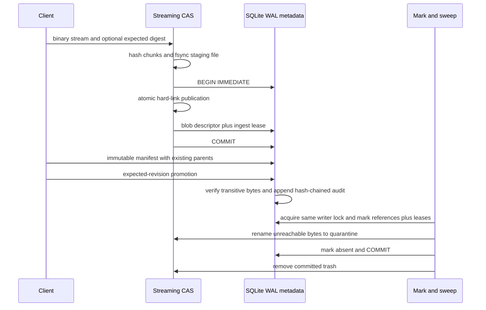

# Artifact publication and release references

`registry.py` owns publication, immutable versioned lineage, CAS environment releases, rollback/audit, leases, and garbage collection. `experiment.py` creates bounded real local artifacts and exercises lifecycle behavior. The CLI writes JSON reports. Tests include separate processes exiting inside real filesystem/SQLite crash windows; no cloud or LLM is used.

Metadata is trusted application state inside a private local directory. Binary contents are untrusted and verified against content addresses. Manifests are finite bounded JSON; supplied artifact IDs cannot become arbitrary paths. Every operation that changes reachability shares the SQLite writer lock with collection. Read verification also holds that lock while returning checksum-verified bytes.

See [registry-transactions.md](registry-transactions.md) for algorithms, failure states, and the exact meaning of the guarantees.
